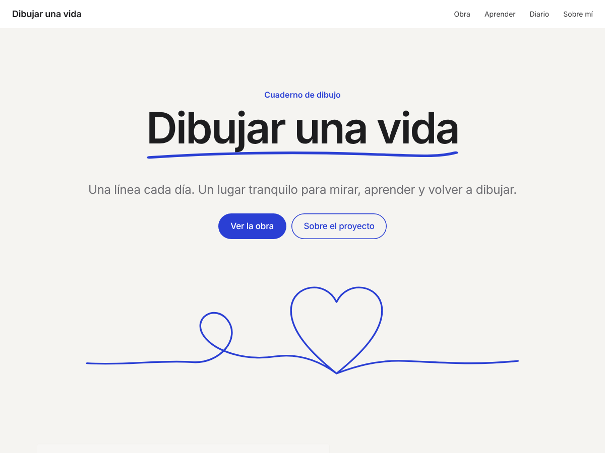

# Art Child

Tema hijo de [Kadence](https://wordpress.org/themes/kadence/) para **[Dibujar una vida](https://dibujarunavida.com/)**, mi proyecto personal sobre el arte de dibujar.

> ¿Quieres que tu web llegue más lejos? Contrata **SEO y GEO** en [trailseo.com](https://trailseo.com/) y el **mantenimiento de tu WordPress** en [nexopress.com](https://nexopress.com/).



## La idea

Diseño inspirado en Apple y fiel al principio KISS: la obra manda y la interfaz se aparta.

- **Un solo gesto creativo, la línea continua.** Aparece en el titular (estilo *Trazo*), en la portada y en la firma del pie, y se dibuja sola.
- **Tipografía del sistema** (San Francisco en Apple), con tracking negativo en los titulares y escala amplia.
- **Material translúcido** en la cabecera fija: el contenido se ve, desenfocado, al pasar por debajo.
- **Sin JavaScript ni dependencias.** Un CSS, un `functions.php` y tres patrones.
- **Accesible:** respeta *movimiento reducido*, *transparencia reducida* y *más contraste*. Texto, enlaces y botones cumplen el contraste WCAG AA.

## Archivos

```
art-child/
├── style.css               Cabecera del tema y todos los estilos
├── functions.php           Paleta, tipografía, estilos de bloque, lightbox y firma
├── template-parts/
│   └── firma.php           Créditos del proyecto (edita aquí el texto)
├── patterns/               Patrones de bloque: portada, obra, proyecto
├── assets/img/             Dibujos de una sola línea (SVG animado)
└── screenshot.png
```

## Instalación

1. Ten instalado el tema **Kadence** (no hace falta activarlo).
2. Sube la carpeta `art-child` a `wp-content/themes/` o instálala como .zip desde *Apariencia → Temas → Añadir nuevo*.
3. Activa **Art Child**.

**Si ya usabas Kadence:** WordPress guarda los ajustes del Personalizador por tema, así que el tema hijo empieza limpio. Para llevarte tu cabecera, menús y demás, exporta los ajustes antes de cambiar con el plugin *Customizer Export/Import* y vuelve a importarlos después.

**Paleta:** al activar el tema se aparca tu paleta de Kadence y se aplica la de Art Child. Si vuelves a cambiar de tema, la tuya se restaura sola.

## Qué incluye

| | |
|---|---|
| **Paletas** | *Día* (papel cálido y azul ultramar) y *Noche*. Cámbialas en *Personalizar → Colores*. Cada color lleva el nombre de un material de dibujo: Ultramar, Tinta, Grafito, Carboncillo, Papel… |
| **Tipografía** | Escala de titulares de 56 a 13 px, con interlineado ajustado. Todo editable en *Personalizar → Tipografía*. |
| **Estilos de bloque** | **Trazo** (Encabezado): subrayado a mano alzada. **Marco** (Imagen): paspartú y sombra de obra colgada. **Lámina** (Grupo): tarjeta blanca y suave. |
| **Patrones** | *Dibujar una vida* en el insertador: **Portada**, **Obra destacada** y **Sobre el proyecto** (con los enlaces a trailseo.com y nexopress.com). |
| **Lightbox** | Las imágenes se amplían al hacer clic, para ver la obra en grande. |
| **Firma** | Al pie de cada página: el proyecto es personal, más los enlaces a los servicios. |

## Ajustes recomendados

- **Portada:** en la página de inicio, desactiva el título y elige el diseño *Ancho completo / Sin caja* (panel de Kadence en el editor). Inserta luego los tres patrones.
- **Cabecera fija:** viene activada por defecto. Si la desactivaste, reactívala en *Personalizar → Cabecera → Cabecera fija* para ver el efecto translúcido.

## Personalizar

- **Texto de la firma:** `template-parts/firma.php`.
- **Quitar la firma:** añade en un plugin propio `remove_action( 'kadence_after_footer', 'art_child_firma' );`.
- **Colores:** desde el Personalizador. Todo el CSS se apoya en la paleta de Kadence.

## Créditos

Diseñado para [dibujarunavida.com](https://dibujarunavida.com/), un proyecto personal.
SEO y GEO: [trailseo.com](https://trailseo.com/) · Mantenimiento de WordPress: [nexopress.com](https://nexopress.com/)

Licencia GPL v3 o posterior, como Kadence.
